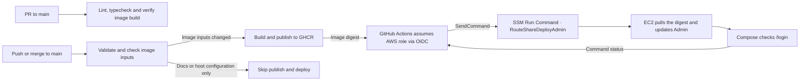

# RouteShare Admin Deployment

GitHub Actions builds the Next.js Admin image and publishes it to GitHub Container Registry (GHCR). AWS Systems Manager (SSM) deploys the published digest to EC2. Admin runs in the `routeshare-admin` Compose project and shares the Backend Docker network.

1. **Validate and publish.** A PR runs lint, type checking and a container build. A push to `main` publishes when application source, assets, dependencies or build configuration change. A manual run on `main` can also publish. The image is tagged with the commit SHA and the job outputs its registry digest.
2. **Trigger deployment.** The deploy job uses GitHub OIDC and sends the digest as `ImageDigest` to `RouteShareDeployAdmin`. The `production` environment supplies the target EC2 instance ID and IAM role ARN. GitHub Actions records the SSM command ID and waits for its result.
3. **Update Admin.** The SSM Agent invokes `/usr/local/sbin/routeshare-deploy-admin`. The script uses the EC2 instance role to read the `ghcr-pull` SecureString from Parameter Store, authenticates to GHCR and pulls the exact digest. Compose updates the Admin service and checks `/login` on port `3001`.

The host reads Compose from `/etc/routeshare/admin/compose.yml`. Install reviewed changes to Compose or the deploy script on EC2 when those files change. The shared Nginx proxy serves Admin over HTTPS, and the Next.js server calls Backend GraphQL over the Docker network.

See the [GitHub Actions workflow](../.github/workflows/ci.yml), [Compose configuration](compose.yml) and [deploy script](deploy.sh).
